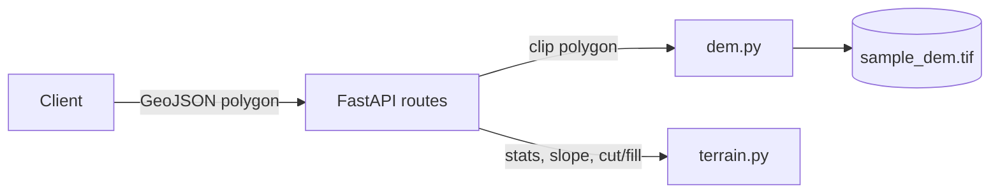

# Site Feasibility API

A preliminary site feasibility API: submit a parcel polygon and get back
terrain stats, slope, and the cut/fill volume and cost to level the parcel
to a target platform elevation.

## Architecture



- `app/main.py` — creates the FastAPI app and mounts the router.
- `app/api/routes.py` — `POST /assessment` and `POST /earthwork`; returns 422 if the polygon isn't usable.
- `app/models/schemas.py` — request/response models and GeoJSON polygon validation.
- `app/services/dem.py` — loads the sample DEM once, reprojects the polygon, and clips the DEM to it.
- `app/services/terrain.py` — pure NumPy math: elevation stats, slope, cut/fill volumes.
- `data/sample_dem.tif` — the 30m elevation raster `dem.py` reads.

## Quick start

With Docker:

```bash
docker compose up --build
```

Then open `http://localhost:8000/docs` for the interactive Swagger UI.

With a local virtualenv:

```bash
python -m venv .venv
.venv\Scripts\activate       # Windows; use `source .venv/bin/activate` on macOS/Linux
pip install -r requirements.txt
uvicorn app.main:app --reload
```

Run the tests:

```bash
pytest -v
```

## API

### `POST /assessment`

Request — a ~4.9 ha parcel in Arraiján, Panama:

```json
{
  "polygon": {
    "type": "Polygon",
    "coordinates": [[
      [-79.616, 8.929], [-79.614, 8.929],
      [-79.614, 8.931], [-79.616, 8.931], [-79.616, 8.929]
    ]]
  }
}
```

Response:

```json
{
  "area_m2": 48644.18,
  "elevation": { "min": 78.77, "max": 168.37, "mean": 114.27 },
  "slope": { "mean_deg": 17.43, "max_deg": 24.90 }
}
```

### `POST /earthwork`

Same polygon, plus a target platform elevation and a unit cost. Leveling to
the parcel's mean elevation balances cut and fill:

```json
{
  "polygon": { "...": "same as above" },
  "platform_elev_m": 114.3,
  "unit_cost_usd": 8
}
```

```json
{
  "cut_m3": 573617.25,
  "fill_m3": 575111.5,
  "net_m3": -1494.25,
  "est_cost_usd": 9189830.0
}
```

Leveling instead to the parcel's low point means almost no fill, and a much
higher cost:

```json
{ "platform_elev_m": 78.8, "unit_cost_usd": 8 }
```

```json
{
  "cut_m3": 2043329.13,
  "fill_m3": 23.41,
  "net_m3": 2043305.75,
  "est_cost_usd": 16346820.26
}
```

A polygon that isn't fully inside the sample DEM's coverage returns `422`.

## Data

Elevation comes from [Copernicus GLO-30](https://registry.opendata.aws/copernicus-dem/)
(Copernicus DEM — Global and European Digital Elevation Model), distributed
via the AWS Open Data Registry's `copernicus-dem-30m` bucket.
`data/prepare_dem.py` downloads the public tile covering Panama City,
windows and reprojects a 3km × 3km box centered near Arraiján (west of the
Panama Canal) into EPSG:32617 (UTM 17N) at its native 30m resolution, and
writes it to `data/sample_dem.tif`.

Per the Copernicus DEM license (the sample is a reprojected, clipped
derivative):

> produced using Copernicus WorldDEM-30 © DLR e.V. 2010-2014 and © Airbus
> Defence and Space GmbH 2014-2018 provided under COPERNICUS by the European
> Union and ESA; all rights reserved.
>
> The organisations in charge of the Copernicus programme by law or by
> delegation do not incur any liability for any use of the Copernicus
> WorldDEM-30.

## Limitations

- 30m DEM resolution — these are preliminary estimates, not engineering-grade design.
- Cut/fill counts whole raster cells whose center falls inside the parcel, not the true clipped area at the boundary — on the example parcel above, this overestimates volume by roughly 18%.
- Earthwork assumes a single flat target platform; no terracing or benching.
- No soil swell/compaction, haul distance, or other construction-cost factors beyond `unit_cost_usd × volume`.
- Only the bundled 3km × 3km sample area (Arraiján, Panama) is covered — a polygon outside it returns `422`.

## Roadmap

- Web viewer (Vite + TypeScript + ArcGIS Maps SDK for JavaScript) to draw parcels interactively.
- PostGIS-backed storage for parcels and results.
- Terraced/multi-level platforms instead of a single flat elevation.
- Area-weighted (not whole-cell) clipping, to remove the volume overestimate.

---

Developed with AI assistance (Claude Code); every change reviewed and tested.
